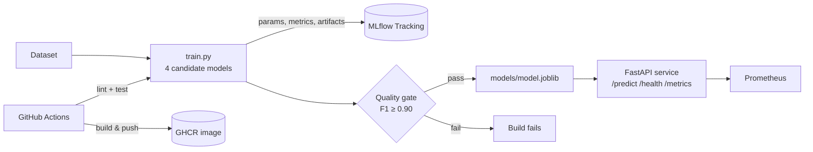

# MLOps End-to-End Pipeline


A production-style machine learning pipeline that goes from **training → experiment tracking → quality gate → containerised model serving → monitoring → CI/CD**, using a small, real dataset (scikit-learn's Breast Cancer Wisconsin dataset) so the whole loop runs on a laptop in under a minute.

## Architecture



## Features

- **Experiment tracking:** every candidate (Logistic Regression and Random Forest variants) is logged to MLflow with params, metrics (accuracy, F1, ROC-AUC) and the model artifact.
- **Automatic model selection + quality gate:** the best model by F1 is exported. The build fails if it is below `MIN_F1`.
- **Inference API:** FastAPI with request validation, `/health`, `/model` metadata and batch `/predict`.
- **Observability:** Prometheus counters and latency histograms at `/metrics`, with a ready-made Prometheus scrape config.
- **Reproducible container:** a multi-stage Dockerfile trains the model at build time and ships a slim, non-root runtime image with a healthcheck.
- **CI/CD:** GitHub Actions runs ruff and pytest, then builds and pushes the image to GitHub Container Registry on `main`.

## Project structure

```
mlops-end-to-end-pipeline/
├── src/
│   ├── train.py          # training, MLflow logging, model selection, quality gate
│   └── serve.py          # FastAPI inference service + Prometheus metrics
├── tests/
│   └── test_pipeline.py  # end-to-end test: train → serve → predict
├── .github/workflows/ci.yml
├── Dockerfile            # multi-stage: train → slim runtime
├── docker-compose.yml    # MLflow + API + Prometheus
├── prometheus.yml
├── Makefile
└── requirements*.txt
```

## Quick start

### Local

```bash
git clone https://github.com/Muhammad-HamzaShamsi/mlops-end-to-end-pipeline.git
cd mlops-end-to-end-pipeline
python -m venv .venv && source .venv/bin/activate
make install      # install dependencies
make train        # train and log 4 models; best one goes to models/
make test         # run the test suite
make serve        # API at http://localhost:8000/docs
mlflow ui --backend-store-uri sqlite:///mlflow.db   # browse experiments at :5000
```

### Docker Compose (API + MLflow + Prometheus)

```bash
docker compose up --build -d
```

| Service    | URL                          |
|------------|------------------------------|
| API docs   | http://localhost:8000/docs   |
| MLflow UI  | http://localhost:5000        |
| Prometheus | http://localhost:9090        |

## API example

```bash
curl -s localhost:8000/model | jq .metrics

python - <<'EOF'
import requests
from sklearn.datasets import load_breast_cancer
row = load_breast_cancer(as_frame=True).data.iloc[0].to_dict()
print(requests.post("http://localhost:8000/predict", json={"instances": [row]}).json())
EOF
# {'model': 'logreg_c1', 'predictions': [0], 'probabilities': [0.0]}
```

## Configuration

| Variable              | Default                    | Purpose                              |
|-----------------------|----------------------------|--------------------------------------|
| `MLFLOW_TRACKING_URI` | `sqlite:///mlflow.db`      | Where runs are logged                |
| `MLFLOW_EXPERIMENT`   | `breast-cancer-classifier` | Experiment name                      |
| `MODEL_DIR`           | `models`                   | Where the selected model is saved    |
| `MIN_F1`              | `0.90`                     | Quality gate threshold               |

## Sample results

| Candidate   | Accuracy | F1    | ROC-AUC |
|-------------|----------|-------|---------|
| logreg_c0.1 | 0.974    | 0.979 | 0.996   |
| **logreg_c1** | **0.982** | **0.986** | **0.995** |
| rf_100      | 0.956    | 0.966 | 0.994   |
| rf_300_d8   | 0.947    | 0.958 | 0.994   |

## Roadmap

- [ ] Register models in the MLflow Model Registry with stage transitions
- [ ] Deploy to Kubernetes (see [k8s-terraform-ml-infra](https://github.com/Muhammad-HamzaShamsi/k8s-terraform-ml-infra))
- [ ] Data and prediction drift monitoring (see [ml-cicd-drift-monitoring](https://github.com/Muhammad-HamzaShamsi/ml-cicd-drift-monitoring))

## License

MIT © Muhammad Hamza Shamsi
